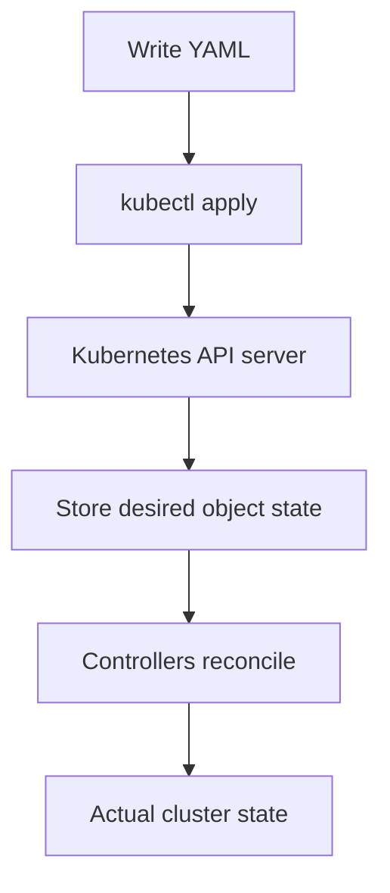

# YAML Fundamentals for Kubernetes

## Learning goals

- Explain what YAML is and why tools use it.
- Read mappings, sequences, nested objects, scalar values, and comments.
- Understand how indentation defines structure.
- Read a Kubernetes manifest as structured data.
- Start writing a manifest from a requirement instead of copying one.

## 1. What is YAML?

YAML is a human-readable **data serialization language**. It represents structured data so that people and programs can exchange or store it.

YAML does not run your application and is not a programming language. A tool reads the YAML and decides what the data means.

```yaml
name: Mohamed
age: 22
is_student: true
skills:
  - Python
  - JavaScript
  - Kubernetes
```

This represents a mapping with four keys. The `skills` key contains a list.

### Why is YAML used?

It is useful for configuration because it is relatively easy to read, write, review, and keep in version control.

| Tool | What YAML describes |
|---|---|
| Kubernetes | Pods, Deployments, Services, ConfigMaps, and other API objects |
| Docker Compose | Services, containers, networks, and volumes |
| GitHub Actions | CI/CD workflows |
| Ansible | Automation tasks and configuration |
| Helm | Kubernetes chart configuration |
| Cloud-init | Machine initialization configuration |

**Important:** YAML is only the data format. Each tool defines its own schema and rules. A file can be valid YAML but still be an invalid Kubernetes manifest because Kubernetes does not recognize a field or its value.

## 2. The basic YAML building blocks

YAML data is commonly built from three kinds of nodes:

1. **Mapping** — key/value pairs, similar to a Python dictionary or JavaScript object.
2. **Sequence** — an ordered list, similar to a Python list or JavaScript array.
3. **Scalar** — a single value, such as a string, number, or Boolean.

### 2.1 Mapping: key/value pairs

```yaml
name: nginx
replicas: 3
enabled: true
```

Think of it as:

```text
mapping
├── name     -> "nginx"
├── replicas -> 3
└── enabled  -> true
```

The general form is `key: value`. Use a space after the colon.

### 2.2 Sequence: lists

A dash followed by a space starts a list item:

```yaml
skills:
  - Python
  - JavaScript
  - Kubernetes
```

A list can contain mappings:

```yaml
containers:
  - name: nginx
    image: nginx:stable-alpine
  - name: redis
    image: redis:alpine
```

This is a list containing two objects. Each object has `name` and `image` keys.

### 2.3 Nested mappings

Indentation expresses parent/child relationships:

```yaml
resources:
  limits:
    cpu: 250m
    memory: 128Mi
```

Tree:

```text
resources
└── limits
    ├── cpu: 250m
    └── memory: 128Mi
```

### 2.4 Scalar values and quoting

```yaml
name: nginx
replicas: 3
enabled: true
version: "1.28"
```

Common scalar types include strings, numbers, and Booleans. Quote values when you want to make it explicit that a value is a string, especially version-like values or strings that could be interpreted as another type.

### 2.5 Comments

```yaml
# Keep two application replicas running
replicas: 2
```

A `#` starts a comment when it is outside a quoted string. Comments are for people; the YAML parser ignores them.

### 2.6 Indentation rules

- Use spaces, never tabs, for indentation.
- Two spaces per nesting level is a common convention.
- Sibling keys must line up.
- A child must be indented further than its parent.
- Be consistent throughout the file.

Correct:

```yaml
spec:
  replicas: 2
  selector:
    matchLabels:
      app: nginx
```

Incorrect:

```yaml
spec:
  replicas: 2
    selector:
      matchLabels:
        app: nginx
```

In the incorrect example, `selector` has been indented as though it were a child of `replicas`.

## 3. YAML is data, not instructions

Consider:

```yaml
replicas: 3
```

YAML itself does not create three servers or start three containers. A program must read that data. In Kubernetes, `kubectl` sends the object to the Kubernetes API server. Kubernetes controllers then work toward the requested state.



The YAML describes the desired state. Kubernetes provides the behavior.

## 4. Understand our Kubernetes Deployment YAML

Our current file is `workloads/deployment.yaml`:

```yaml
apiVersion: apps/v1
kind: Deployment

metadata:
  name: nginx
  namespace: learning-lab

spec:
  replicas: 2

  selector:
    matchLabels:
      app: nginx

  template:
    metadata:
      labels:
        app: nginx

    spec:
      containers:
        - name: nginx
          image: nginx:stable-alpine

          ports:
            - name: http
              containerPort: 80

          resources:
            requests:
              cpu: 50m
              memory: 64Mi
            limits:
              cpu: 250m
              memory: 128Mi

          readinessProbe:
            httpGet:
              path: /
              port: http
            initialDelaySeconds: 2
            periodSeconds: 5

          livenessProbe:
            httpGet:
              path: /
              port: http
            initialDelaySeconds: 5
            periodSeconds: 10
```

Read it from the outside inward.

### 4.1 Identify the Kubernetes object

```yaml
apiVersion: apps/v1
kind: Deployment
```

- `apiVersion` tells Kubernetes which API group/version defines this object.
- `kind` says what kind of object we are declaring.

This object is a Deployment from the `apps/v1` API.

### 4.2 Metadata: identify the object

```yaml
metadata:
  name: nginx
  namespace: learning-lab
```

Metadata identifies the object: its name is `nginx`, and it belongs to the `learning-lab` namespace.

### 4.3 Spec: describe the desired state

```yaml
spec:
  replicas: 2
```

`spec` is where we describe the desired configuration for this Deployment. We want two Pod replicas.

### 4.4 Selector: how the Deployment finds its Pods

```yaml
selector:
  matchLabels:
    app: nginx
```

The Deployment manages Pods whose labels match `app: nginx`.

### 4.5 Template: the recipe for creating Pods

```yaml
template:
  metadata:
    labels:
      app: nginx
  spec:
    containers:
      - name: nginx
        image: nginx:stable-alpine
```

A Deployment needs a Pod template because it must know what each Pod should look like.

- `template.metadata.labels` assigns the label to each Pod.
- `template.spec` describes the Pod's contents.
- `containers` is a sequence, so each container begins with `-`.
- `name` identifies the container inside the Pod.
- `image` identifies the container image to run.

**Critical relationship:** the selector's `matchLabels` must match the Pod template's labels. Here both use `app: nginx`.

### 4.6 Ports

```yaml
ports:
  - name: http
    containerPort: 80
```

This documents the container port and gives it the name `http`. It does not publish port 80 on the Fedora host. Our Service uses this named port as its `targetPort`.

### 4.7 Resource requests and limits

```yaml
resources:
  requests:
    cpu: 50m
    memory: 64Mi
  limits:
    cpu: 250m
    memory: 128Mi
```

- A request is the amount Kubernetes uses when deciding whether a node has enough resources to schedule the Pod.
- A limit caps the container's resource usage.
- `50m` CPU means 50 millicores, or 0.05 of one CPU core.
- `64Mi` means 64 mebibytes of memory.

### 4.8 Health probes

```yaml
readinessProbe:
  httpGet:
    path: /
    port: http
  initialDelaySeconds: 2
  periodSeconds: 5
```

Readiness checks whether the container is ready to receive traffic.

```yaml
livenessProbe:
  httpGet:
    path: /
    port: http
  initialDelaySeconds: 5
  periodSeconds: 10
```

Liveness checks whether the container should be restarted. The nested `httpGet` mapping describes the HTTP check. `path` and `port` are children of `httpGet`, not siblings of it.

## 5. How to write YAML yourself

Do not start by memorizing a complete manifest. Start with the requirement and translate it into data.

Example requirement:

> Create a Deployment named `web`, in namespace `learning-lab`, with three replicas. Each Pod should run an Nginx container using the `nginx:stable-alpine` image and label each Pod with `app: web`.

Translate it in stages.

**Stage 1 — Identify the object**

```yaml
apiVersion: apps/v1
kind: Deployment
```

**Stage 2 — Add its identity**

```yaml
metadata:
  name: web
  namespace: learning-lab
```

**Stage 3 — Add desired replica count**

```yaml
spec:
  replicas: 3
```

**Stage 4 — Add the selector**

```yaml
  selector:
    matchLabels:
      app: web
```

**Stage 5 — Add the Pod template and its labels**

```yaml
  template:
    metadata:
      labels:
        app: web
```

**Stage 6 — Add the container**

```yaml
    spec:
      containers:
        - name: nginx
          image: nginx:stable-alpine
```

Full manifest:

```yaml
apiVersion: apps/v1
kind: Deployment
metadata:
  name: web
  namespace: learning-lab
spec:
  replicas: 3
  selector:
    matchLabels:
      app: web
  template:
    metadata:
      labels:
        app: web
    spec:
      containers:
        - name: nginx
          image: nginx:stable-alpine
```

This is a learning example. It would create a separate Deployment named `web` if applied.

## 6. A practical method for reading any YAML file

When you encounter an unfamiliar YAML file:

1. Find the top-level keys.
2. Identify mappings (`key: value`).
3. Identify lists (lines beginning with `- `).
4. Follow indentation to understand parent/child relationships.
5. Read values in context.
6. Look up the tool's documentation to learn what each key means.

When writing a Kubernetes manifest:

1. Decide which Kubernetes object you need.
2. Find its API version and schema in the Kubernetes documentation.
3. Write `apiVersion`, `kind`, and `metadata`.
4. Add the required `spec`.
5. Add nested fields carefully, checking indentation.
6. Validate and apply it.
7. Inspect the created object with `kubectl get` and `kubectl describe`.

## 7. Validate YAML and Kubernetes manifests

There are two different questions:

- Is this syntactically valid YAML?
- Is this a valid Kubernetes object with fields and values supported by the API?

Kubernetes can validate the manifest against its API schema.

Client-side dry run:

```bash
kubectl apply --dry-run=client -f workloads/deployment.yaml
```

Server-side dry run against the cluster API:

```bash
kubectl apply --dry-run=server -f workloads/deployment.yaml
```

A dry run does not persist the object. It is useful for catching errors before applying a change.

After making a real change:

```bash
kubectl apply -f workloads/deployment.yaml
kubectl get deployment nginx -n learning-lab
kubectl describe deployment nginx -n learning-lab
```

## 8. Common YAML mistakes

### Wrong indentation

```yaml
spec:
  replicas: 2
    selector:
      matchLabels:
        app: nginx
```

`selector` is indented too far.

### Missing space after colon

Avoid:

```yaml
name:nginx
```

Use:

```yaml
name: nginx
```

### Forgetting the list dash

Incorrect:

```yaml
containers:
  name: nginx
  image: nginx:stable-alpine
```

Correct:

```yaml
containers:
  - name: nginx
    image: nginx:stable-alpine
```

### Selector and Pod labels do not match

If the Deployment selector expects `app: nginx`, the Pod template must include `app: nginx`.

### Valid YAML but invalid Kubernetes

A YAML parser can accept an unknown field. Kubernetes still rejects it if that field is not part of the API schema for that object.

## 9. Recommended documentation

1. [YAML 1.2.2 Specification](https://yaml.org/spec/1.2.2/) — the official language specification. You do not need to read all of it now; use it as a reference.
2. [Kubernetes Objects](https://kubernetes.io/docs/concepts/overview/working-with-objects/) — explains objects and desired state.
3. [Kubernetes Deployments](https://kubernetes.io/docs/concepts/workloads/controllers/deployment/) — explains Deployment fields and behavior.
4. [Declarative Configuration](https://kubernetes.io/docs/tasks/manage-kubernetes-objects/declarative-config/) — explains applying configuration files with `kubectl`.

## 10. Exercises — write, don't copy

Try these without looking at the examples above.

### Exercise A — Read the structure

Given:

```yaml
app:
  name: catalog
  replicas: 2
  containers:
    - name: api
      image: example/api:v1
    - name: worker
      image: example/worker:v1
```

Answer:

1. How many top-level keys are under `app`?
2. How many containers are in the list?
3. Is `image` a child of `containers`, or a child of each list item?
4. What is the value of `replicas`?

### Exercise B — Write a small YAML document

Write a YAML file describing:

- An application named `store`.
- Three replicas.
- A list of two containers: `api` and `worker`.
- The API image is `store-api:v1`.
- The worker image is `store-worker:v1`.

Do not worry about Kubernetes fields yet. The goal is to practise mappings, lists, and indentation.

### Exercise C — Kubernetes reasoning

Without applying anything, explain:

1. Why does a Deployment have both `selector` and `template.metadata.labels`?
2. Why is `containers` a list?
3. Why is `template.spec` nested inside `Deployment.spec`?
4. Which line would you change to request four replicas in our existing Deployment?

## 11. Key ideas to remember

- YAML represents structured data; it does not execute applications.
- A mapping is a collection of key/value pairs.
- A sequence is a list, with items introduced by `-`.
- A scalar is a single value.
- Indentation represents hierarchy. Use spaces, not tabs.
- YAML syntax validity and Kubernetes schema validity are different.
- Kubernetes manifests describe desired state.
- Learn to translate requirements into mappings, lists, and nested structures instead of memorizing entire files.
