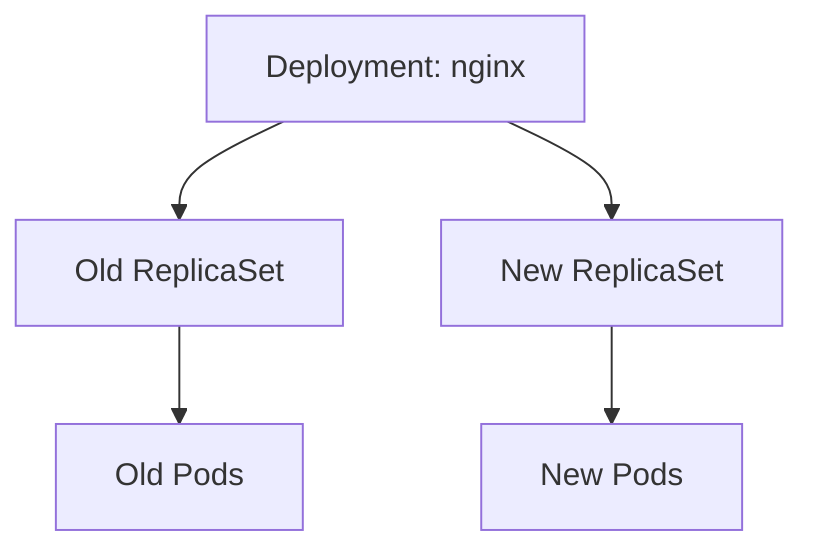
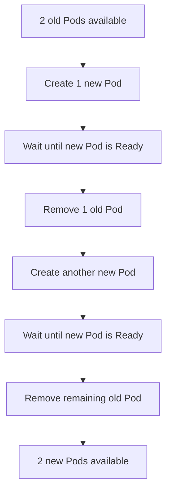

# Milestone 2 — Deployment Scaling, Rolling Updates, and Rollbacks

## What we practised

We modified the existing Nginx Deployment rather than creating a second application.

The Deployment was configured with:

```yaml
spec:
  replicas: 2
  strategy:
    type: RollingUpdate
    rollingUpdate:
      maxSurge: 1
      maxUnavailable: 0
```

We also changed the container image from `nginx:stable-alpine` to `nginx:1.28.0-alpine`, applied the manifest, observed the rollout, inspected ReplicaSets, and checked rollout history.

## 1. Deployment and ReplicaSet relationship

A Deployment manages ReplicaSets. A ReplicaSet maintains the requested number of Pods that match its selector.

When the Pod template changes (for example, when the container image changes), the Deployment creates a new ReplicaSet.



The Deployment keeps track of the old and new ReplicaSets during a rollout. After a successful rollout, the new ReplicaSet has the desired replicas and the old ReplicaSet is scaled down.

## 2. RollingUpdate strategy

```yaml
strategy:
  type: RollingUpdate
  rollingUpdate:
    maxSurge: 1
    maxUnavailable: 0
```

- `type: RollingUpdate` tells the Deployment to replace Pods gradually.
- `maxSurge: 1` allows up to one extra Pod above the desired replica count during the update.
- `maxUnavailable: 0` means the rollout should not intentionally have fewer than the desired number of available replicas.

For two desired replicas, the rollout can temporarily create a third Pod. Once a new Pod becomes Ready, an old Pod can be removed. This repeats until the new ReplicaSet has both replicas.

Simplified sequence:



This is a simplified view. Actual progress depends on Pod readiness, scheduling, image pulls, and other cluster conditions.

## 3. Commands used to inspect a rollout

Check the Deployment:

```bash
kubectl get deployment nginx -n learning-lab
```

Watch Pods:

```bash
kubectl get pods -n learning-lab -w
```

Inspect ReplicaSets:

```bash
kubectl get replicasets -n learning-lab
```

Check rollout progress:

```bash
kubectl rollout status deployment/nginx -n learning-lab
```

View rollout history:

```bash
kubectl rollout history deployment/nginx -n learning-lab
```

Read the current image from the Deployment:

```bash
kubectl get deployment nginx -n learning-lab \
  -o jsonpath='{.spec.template.spec.containers[0].image}'
echo
```

## 4. How to interpret the observed ReplicaSets

During the update, the output showed the new ReplicaSet with one Pod while the old ReplicaSet still had two:

```text
OLD REPLICASET   DESIRED  CURRENT  READY
nginx-old        2        2        2

NEW REPLICASET   1        1        0
```

Then the new ReplicaSet reached two ready Pods and the old ReplicaSet reached zero:

```text
OLD REPLICASET   0        0        0
NEW REPLICASET   2        2        2
```

This is the expected pattern for a successful rolling update with the configured surge and availability settings.

## 5. Rollout history and revisions

Inspect revisions:

```bash
kubectl rollout history deployment/nginx -n learning-lab
```

Kubernetes records Deployment revisions when the Pod template changes. Changes only to fields outside the Pod template do not necessarily create a new revision.

The `CHANGE-CAUSE` column may show `<none>` unless a cause has been recorded. The revision history still exists.

## 6. Rollback

Undo the most recent rollout:

```bash
kubectl rollout undo deployment/nginx -n learning-lab
```

Check that it completed:

```bash
kubectl rollout status deployment/nginx -n learning-lab
```

Inspect the active image:

```bash
kubectl get deployment nginx -n learning-lab \
  -o jsonpath='{.spec.template.spec.containers[0].image}'
echo
```

**Important:** `kubectl rollout undo` changes the live Deployment in the cluster. It does not edit the YAML file in Git.

After experimenting with rollback, make sure the manifest and live cluster are aligned again:

```bash
kubectl apply -f workloads/deployment.yaml
kubectl rollout status deployment/nginx -n learning-lab
```

Then inspect the image in both places:

```bash
grep 'image:' workloads/deployment.yaml

kubectl get deployment nginx -n learning-lab \
  -o jsonpath='{.spec.template.spec.containers[0].image}'
echo
```

The desired image in the file should match the image in the live Deployment.

## 7. Dry-run validation

Client-side dry run:

```bash
kubectl apply --dry-run=client -f workloads/deployment.yaml
```

Server-side dry run:

```bash
kubectl apply --dry-run=server -f workloads/deployment.yaml
```

A server-side dry run sends the request to the API server for validation and admission processing without persisting the change.

## 8. Key concepts

- A Deployment manages ReplicaSets.
- A ReplicaSet maintains the requested number of matching Pods.
- Changing the Pod template creates a new Deployment revision and ReplicaSet.
- Rolling updates gradually replace old Pods with new Pods.
- `maxSurge` controls temporary extra Pods.
- `maxUnavailable` controls how many Pods may be unavailable during an update.
- `kubectl rollout status` checks rollout progress.
- `kubectl rollout history` lists revisions.
- `kubectl rollout undo` rolls back the live Deployment.
- A rollback does not modify the YAML file in the repository.
- Keep the Git manifest and live cluster state aligned.

## 9. Next experiment

The next milestone will deliberately use an invalid container image name to observe `ErrImagePull` and `ImagePullBackOff`, then diagnose and repair the Deployment using:

```bash
kubectl describe pod ...
kubectl get events ...
kubectl logs ...
```

The goal is to learn how to find the cause of a failed workload instead of guessing.
